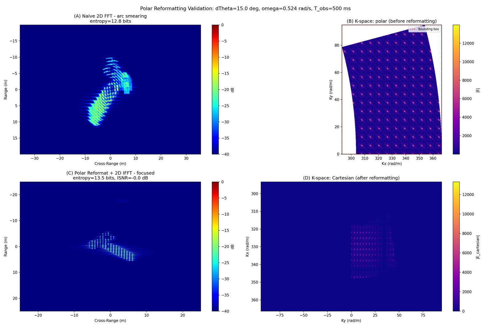
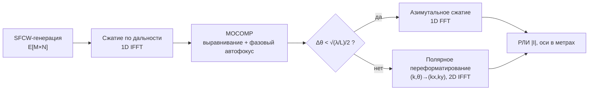
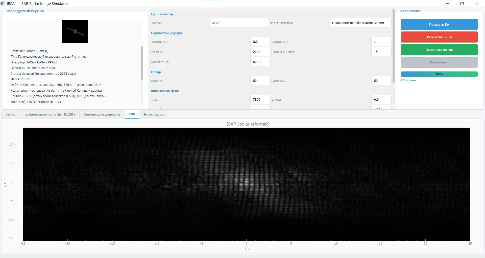
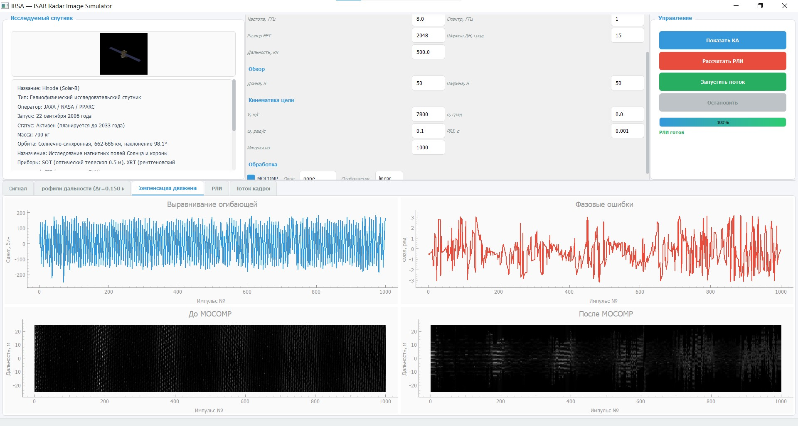

# IRSA — симулятор ISAR: от эхо-сигнала к радиолокационному изображению

<div align="center">

Модель SFCW-радара · 5 реальных космических миссий · полный конвейер: сжатие → MOCOMP → фокусировка · Python + PyQt5

[](https://www.python.org/)
[](LICENSE)
[](https://github.com/ddddrill/irsa-rli/releases)
[](#тесты-и-воспроизводимость)
[](https://doc.qt.io/qt-5/)



<sub>Δθ = 15° · X-диапазон 8 ГГц · B = 1.5 ГГц · N = 1000. Воспроизвести: `python -m examples.demo_polar_reformatting_validation`</sub>

</div>

---

## Содержание

- [Что это такое](#что-это-такое)
- [Quick Start](#quick-start)
- [Физика: как радар «видит» спутник](#физика-как-радар-видит-спутник)
- [Конвейер](#конвейер)
- [Архитектура проекта](#архитектура-проекта)
- [Возможности](#возможности)
- [Графический интерфейс](#графический-интерфейс)
- [Демо-скрипты](#демо-скрипты)
- [Установка](#установка)
- [Параметры](#параметры)
- [Тесты и воспроизводимость](#тесты-и-воспроизводимость)
- [Ограничения и планы](#ограничения-и-планы)
- [Литература и цитирование](#литература-и-цитирование)
- [Лицензия](#лицензия)

---

## Что это такое

**IRSA** — симулятор радара с инверсной синтезированной апертурой (ISAR): он синтезирует эхо-сигнал SFCW-радара от вращающейся цели и проводит его через полный конвейер обработки — до готового радиолокационного изображения (РЛИ) космического аппарата.

- **Полный цикл в одном окне:** сырые I/Q-отсчёты → профили дальности → MOCOMP → фокусировка → РЛИ; каждый этап виден на отдельной вкладке GUI.
- **5 реальных миссий** в роли целей: CloudSat, CALIPSO, ICESat-2, LRO, Hinode (Solar-B) — упрощённые модели точечных рассеивателей.
- **Два пути фокусировки:** Range-Doppler для малых углов и полярное переформатирование для больших — с автоматическим выбором по физическому порогу √(λ/L)/2.
- **Детерминированность:** все случайные эффекты (шум, анизотропия, фазовый шум) — из seeded RNG; один seed — побитово одинаковый результат при любом SNR.

Кому нужно: студентам и аспирантам (тренажёр Range-Doppler / MOCOMP / полярного переформатирования), исследователям (песочница до выхода на реальный радар), преподавателям (11 демо с PNG-выходом), инженерам (модульный референс на Python).

**Вопросы-эксперименты** — каждый проверяется за минуту:

- «Что будет, если уменьшить полосу в 2 раза?» — разрешение по дальности $\Delta r = c/(2B)$ упадёт вдвое.
- «Как MOCOMP справляется с поступательным движением ≈ 7.5 км/с?» — Range Walk и фазовая развёртка убираются (демо 3).
- «Что произойдёт, если спутник повернётся на 15°?» — в стандартном конвейере arc smearing; полярное переформатирование возвращает точки в фокус.
- «Какой суммарный угол Δθ допустим для моих параметров?» — физический порог Δθ < √(λ/L)/2 (врезка в разделе «Физика»).

---

## Quick Start

```bash
git clone https://github.com/ddddrill/irsa-rli.git
cd irsa-rli
python -m venv .build_venv

# Windows:      .build_venv\Scripts\activate
# Linux / macOS: source .build_venv/bin/activate

pip install -r requirements.txt

# 1) GUI-симулятор
python main.py

# 2) или без GUI — демо-скрипты сами сохраняют PNG:
python -m examples.demo_full_pipeline_mocomp

# 3) или тестовый прогон конвейера:
python -m pytest -q
```

Не хотите ставить Python? В [Releases](https://github.com/ddddrill/irsa-rli/releases) лежит собранный Windows-архив (PyInstaller): распаковать и запустить `IRSA.exe`.

---

## Физика: как радар «видит» спутник

### Что такое ISAR

Обычный радар измеряет **дальность** до объекта — расстояние по лучу. Этого мало: непонятно, **где** в поперечном направлении (по азимуту) находится отражатель.

**ISAR (Inverse Synthetic Aperture Radar)** решает эту задачу за счёт **вращения цели**. Если объект поворачивается относительно радара, разные его точки имеют разную лучевую скорость → разный доплеровский сдвиг → их разделяет БПФ по частоте.

> Представьте вертушку: лопасти вращаются, кончик каждой лопасти движется быстрее основания. Радар «видит» это как разные доплеровские частоты. Точка на расстоянии $x$ от оси вращения даёт $f_d = \frac{2\omega x}{\lambda}$ — линейка этих частот и есть азимут (cross-range).

Числа по умолчанию для X-диапазона:

| Величина | Формула | Значение |
|---|---|---|
| Длина волны | λ = c / f_c | 3.75 см (8 ГГц) |
| Разрешение по дальности | Δr = c / (2B) | 0.30 м (B = 0.5 ГГц) |
| Разрешение по азимуту | Δx = λ / (2·Δθ) | ≈ 0.36 м (при Δθ = 3°) |
| Доплер точки на x = 10 м | f_d = 2·ω·x / λ | ≈ ±280 Гц (при ω = 0.52 рад/с) |
| Суммарный угол поворота | Δθ = ω·N·PRI | 15° (N = 1000, PRI = 0.5 мс, ω = 0.524 рад/с) |

### Сигнал SFCW

В проекте используется **SFCW (Stepped Frequency Continuous Wave)** — радар, который излучает импульсы на последовательно меняющихся частотах:

```
Частота:   f₀,  f₀+Δf, f₀+2Δf, ..., f₀+(M-1)·Δf
Импульс:   n=0,  n=1,  n=2,    ..., n=N-1
```

Каждый отсчёт — комплексное число (I/Q), пропорциональное напряжённости поля, отражённого целью. На выходе — матрица E[M×N] (частоты × импульсы).

### Дальность и азимут

- **Дальность (Range)** восстанавливается по быстрому времени (внутри импульса) через IFFT по оси частот. Разрешение: $\Delta r = c / (2B)$.
- **Азимут (Cross-Range)** восстанавливается по медленному времени (между импульсами) через FFT по оси доплеровских частот. Разрешение: $\Delta x = \lambda / (2\omega T_{\text{obs}})$.

### Почему нужно учитывать движение

Спутник не просто вращается — он движется по орбите со скоростью ≈ 7.5 км/с. Поступательное движение приводит к:

- **Range Walk** — каждая точка «ползёт» по бинам дальности от импульса к импульсу (косые линии на профилях).
- **Фазовому набегу** — линейный фазовый тренд по медленному времени, размывающий азимутальное FFT.

Без компенсации РЛИ теряет фокус. **MOCOMP** (Motion Compensation) — обязательный шаг перед азимутальным сжатием.

### Проблема больших углов и полярное переформатирование

При малых углах обзора данные в **k-пространстве** (пространстве волновых чисел) лежат почти на прямоугольной сетке, и 2D БПФ работает корректно. При больших углах (типично для ISAR X-диапазона на длинных экспозициях) сетка становится **кольцевым сектором** — и 2D БПФ даёт **arc smearing** (размазню в виде дуг).

Решение — **полярное переформатирование**: пересчёт данных с полярной сетки на декартову перед 2D IFFT.

> **Порог включения полярного пути.** В коде (`should_use_polar_reformat`) порог — физический критерий применимости узкоугольной полярной аппроксимации: $\Delta\theta_{\max} \approx \sqrt{\lambda/L}/2$ (C. Chen, M. Martorella, *Inverse Synthetic Aperture Radar Imaging*, IET, 2014, §3.1). Для X-диапазона и цели размером L = 20 м это ≈ 1.2°. Если длина волны или размер цели неизвестны, код использует запасной эмпирический порог **3°**. Практически: при Δθ ниже порога искажения стандартного конвейера малозаметны, выше — включается полярный путь.

---

## Конвейер



| Этап | Модуль | Что делает |
|------|--------|------------|
| Генерация | `simulation/raw_generator.py` | E[m,n] = Σ σᵢ · exp(−j4πfₘRᵢ(tₙ)/c) |
| Сжатие по дальности | `processing/range_compress.py` | 1D IFFT по частотам + дешифровка |
| MOCOMP | `processing/mocomp.py` | Выравнивание огибающей (суббиновое) + фазовый автофокус |
| Сжатие по азимуту (стандарт) | `processing/azimuth_compress.py` | 1D FFT по импульсам |
| Полярное переформатирование | `processing/polar_reformat.py` | (k,θ) → (kx,ky), билин. интерполяция, окно, 2D IFFT |
| Keystone (опция) | `processing/keystone.py` | Устранение остаточной миграции по дальности |
| TF-анализ / RID (опция) | `processing/tf_analysis.py` | STFT-спектрограммы, WVD, RID-кадры |
| Кросс-масштаб (опция) | `processing/cross_range_scaling.py` | Оценка ω по данным (phasefit) → физическая ось |

---

## Архитектура проекта

```
irsa-rli/
├── main.py                      # Точка входа GUI
├── config.py                    # AppConfig, пресеты, сериализация в config.json
├── paths.py                     # Пути приложения (radioimage/ — генерируется при работе)
├── filenames.py                 # Маппинг имён миссий → файлы моделей
├── build.bat / IRSA.spec        # Сборка автономного exe (PyInstaller)
│
├── models/                      # radar.py, target.py — параметры сцены
├── simulation/                  # raw_generator.py, эффекты реализма, центральный rng.py
├── processing/                  # ядро: range_compress, mocomp, azimuth_compress,
│                                #   polar_reformat, keystone, tf_analysis,
│                                #   cross_range_scaling, windows, data_processor, isar_processor
├── ui/                          # main_window.py (6 вкладок), styles.py
├── examples/                    # 12 скриптов (11 демо + интеграционный тест)
├── tests/                       # pytest-набор (14 файлов, 78 тестов)
│
├── matrices/                    # модели миссий (.pkl)
├── sat_info_p/                  # изображения и паспорта миссий
├── assets/                      # иконки, скриншоты, assets/readme/
├── radioimage/                  # создаётся автоматически при работе (paths.py:app_dir)
│
├── requirements.txt             # зависимости с верхними границами
├── CHANGELOG.md · CONTRIBUTING.md · PARAMETERS_GUIDE.md · LICENSE
```

---

## Возможности

**Моделирование**

- 5 миссий-целей: CloudSat, CALIPSO, ICESat-2, LRO, Hinode — модели рассеивателей (.pkl) с паспортами и изображениями.
- SFCW-радар с параметризуемой несущей, полосой, числом частот, шириной ДН.
- Кинематика: поступательное движение (V, α), вращение (ω), угловое ускорение (γ) и микровибрация (микро-Доплер).

**Эффекты реализма** *(v2.4.0; все выключены по умолчанию, пресеты «Идеальный / Реалистичный»)*

- комплексные амплитуды рассеивателей σᵢ·e^(jφᵢ) и анизотропия ЭПР по углу;
- геометрическое затенение (occlusion) и двухпутевая ДН антенны с ошибкой наведения;
- фазовый шум гетеродина (винеровский процесс) и аддитивный шум с заданным SNR.

**Обработка**

- сжатие по дальности (1D IFFT) и по азимуту (1D FFT);
- окна: none / hamming / hann / kaiser / chebwin / taylor + взвешивание по дальности;
- MOCOMP v2: суббиновое выравнивание огибающей (усреднённая опора) + фазовый автофокус;
- полярное переформатирование для больших Δθ: k-space, билинейная интерполяция, окно Тейлора, 2D IFFT; автоматический выбор конвейера по физическому порогу √(λ/L)/2;
- keystone (опция) — устранение остаточной миграции по дальности;
- кросс-range масштабирование по данным (метод phasefit) вместо осевой ω из конфигурации;
- время-частотный анализ: STFT-спектрограммы, WVD, RID-кадры — маневрирующая цель (γ ≠ 0);
- метрики фокусировки: энтропия изображения, ISNR; отображение linear/dB.

**Инструментарий**

- GUI на PyQt5 + pyqtgraph: 6 вкладок = 6 стадий конвейера, tooltips с формулами;
- 12 скриптов в `examples/` (11 демо + интеграционный тест) с автосохранением PNG;
- pytest-набор (14 файлов, 78 тестов): обратная совместимость, детерминизм по seed, юнит-тесты эффектов и новых модулей, интеграционный прогон конвейера;
- seeded RNG: одинаковый seed → побитово одинаковый результат (проверяется тестом).

---

## Графический интерфейс

PyQt5 + pyqtgraph: сверху — параметры сцены (радар / обзор / кинематика / обработка, у каждого поля tooltip с физическим смыслом и формулой), снизу — 6 вкладок результатов.

<p align="center">
  
</p>
<p align="center">
  
</p>

| Вкладка | Что показывает |
|---|---|
| **Сигнал** | SFCW-лесенка, спектр, параметры импульса |
| **Профили дальности** | heatmap дальность × импульсы после IFFT |
| **Компенсация движения** | сдвиги огибающей, фазовые ошибки, до/после MOCOMP |
| **РЛИ** | финальное изображение, оси в метрах, linear/dB |
| **Сигнатуры** | время-частотный анализ: STFT-спектрограмма, WVD, RID-кадр |
| **Поток кадров** | покадровая анимация расчёта |

Полный список полей и их смысл — в [PARAMETERS_GUIDE.md](PARAMETERS_GUIDE.md).

---

## Демо-скрипты

Все скрипты в `examples/`, запускаются из корня проекта, каждый сохраняет PNG в ту же директорию.

| # | Скрипт | Что демонстрирует |
|---|--------|-------------------|
| 1 | `demo_ideal_turntable.py` | Чистое вращение (V = 0): MOCOMP не нужен, конвейер честен сам по себе |
| 2 | `demo_motion_blur.py` | V ≠ 0 без MOCOMP: Range Walk, РЛИ теряет фокус |
| 3 | `demo_full_pipeline_mocomp.py` | Тот же сценарий с MOCOMP: точки фокусируются |
| 4 | `demo_large_angle.py` | Δθ = 15°: arc smearing и его лечение полярным путём |
| 5 | `demo_polar_reformatting_validation.py` | Тройное сравнение: наивный 2D FFT / k-space / полярный путь |
| 6 | `demo_maneuvering_target.py` | Маневрирующая цель (γ ≠ 0): RD vs STFT vs RID-кадр |
| 7 | `demo_keystone.py` | Keystone: миграция 8.5 бинов дальности убирается до фокуса |
| 8 | `demo_cross_range_scaling.py` | Кросс-range масштабирование по данным (phasefit) |
| 9 | `demo_micro_doppler_stft.py` | Микро-Доплер вибрации: STFT-спектрограмма |
| 10 | `demo_rid_imaging.py` | RID-кадр «замораживает» вращение маневрирующей цели |
| 11 | `demo_realism_effects.py` | Все эффекты реализма v2.4.0 одним сравнением (6 панелей) |
| 12 | `test_data_processor_polar.py` | Интеграционный тест с [OK]-проверками сфокусированности и осей |

```bash
python -m examples.demo_ideal_turntable            # 1
python -m examples.demo_motion_blur                # 2
python -m examples.demo_full_pipeline_mocomp       # 3
python -m examples.demo_large_angle                # 4
python -m examples.demo_polar_reformatting_validation   # 5
python -m examples.demo_maneuvering_target         # 6
python -m examples.demo_keystone                   # 7
python -m examples.demo_cross_range_scaling        # 8
python -m examples.demo_micro_doppler_stft         # 9
python -m examples.demo_rid_imaging                # 10
python -m examples.demo_realism_effects            # 11
python -m examples.test_data_processor_polar       # 12
```

Подробное описание каждого демо и его параметров — в [examples/README.md](examples/README.md).

---

## Установка

### Требования

- Python 3.10+ (протестировано на 3.12)
- numpy < 2, scipy < 1.12, matplotlib < 3.9 — границы зафиксированы в `requirements.txt`
- PyQt5 ≥ 5.15, pyqtgraph ≥ 0.13 — GUI
- opencv-python ≥ 4.7, Pillow ≥ 9.5 — загрузка изображений
- pytest ≥ 7.0 — тесты

Верхние границы версий — осознанное решение проекта (совместимость вычислительного ядра); ставьте зависимости из `requirements.txt`, а не вручную.

### Windows, Linux, macOS

```bash
python -m venv .build_venv
# Windows:      .build_venv\Scripts\activate
# Linux / macOS: source .build_venv/bin/activate
pip install -r requirements.txt
python main.py
```

**VS Code:** откройте папку проекта → `Ctrl+Shift+P` → `Python: Select Interpreter` → выберите `Python 3.12 (.build_venv)`. Терминал автоматически активирует venv.

### Сборка exe (Windows)

`build.bat` собирает автономный `IRSA.exe` через PyInstaller (`IRSA.spec`). Готовые сборки — в [Releases](https://github.com/ddddrill/irsa-rli/releases).

---

## Параметры

| Параметр | По умолчанию | Смысл |
|---|---|---|
| `f_c` | 8 ГГц | несущая (X-диапазон) → λ = 3.75 см |
| `B` | 0.5 ГГц | полоса → Δr = c/(2B) = 0.3 м |
| `PRI` / `N` | 1.0 с / 1000 | темп и число импульсов → T_obs |
| `ω` / `γ` | auto / 0 | угловая скорость и ускорение вращения |
| `V`, `α` | 0 м/с, 0° | поступательное движение (нужен MOCOMP) |
| `MOCOMP` | вкл | компенсация движения |
| `window` | none | none / hamming / hann / kaiser / chebwin / taylor |
| `method` | стандартный | стандартный / с полярным переформатированием (авто по порогу) |

Полный справочник с допустимыми диапазонами и рекомендациями — [PARAMETERS_GUIDE.md](PARAMETERS_GUIDE.md).

| Что хотим | Что крутить |
|---|---|
| Лучше разрешение по дальности | ↑ B, ↑ nifft_size |
| Лучше разрешение по азимуту | ↑ Δθ (больше суммарный угол поворота) |
| Меньше боковых лепестков | window = hamming / hann |
| Чётко при больших Δθ | полярное переформатирование |
| Подавить поступательное движение | MOCOMP |
| Снять задержку апертуры при γ ≠ 0 | TF-конвейер (вкладка «Сигнатуры») |

---

## Тесты и воспроизводимость

```bash
python -m pytest -q          # обратная совместимость, детерминизм, эффекты, интеграция, юнит-тесты модулей, геометрическая истинность
python -m examples.test_data_processor_polar   # интеграционный прогон с метриками и [OK]-проверками
```

Что проверяется автоматически:

- **обратная совместимость** — с выключенными эффектами генератор воспроизводит классическую формулу точечных рассеивателей;
- **детерминизм** — один seed даёт побитово одинаковые данные (центральный seeded RNG, `simulation/rng.py`); обещание верно **при любом SNR**, включая конечный (шум AWGN берётся из подгенератора `spawn_rng(seed, "awgn")` — фикс G2, ранее шум шёл из глобального `np.random` и воспроизводимость при SNR < ∞ нарушалась);
- **корректность эффектов реализма** — юнит-тесты амплитуд, затенения, фазового шума;
- **новые модули R2–R8** — юнит-тесты keystone, кросс-масштабирования, TF-анализа, суббинового MOCOMP, физического порога;
- **сквозной конвейер** — стандартный и полярный пути выдают сфокусированные РЛИ с физическими осями.

Ручной регламент приёмки GUI (что считать «поломанным») — в [CONTRIBUTING.md](CONTRIBUTING.md).

---

## Ограничения и планы

Проект фиксирует границы применимости текущей версии:

- **Автофокус** реализован одним методом — по опорному рассеивателю (PPP). PGA и контрастные методы (ICBA) не реализованы: при отсутствии доминирующего отражателя качество фокусировки падает.
- **Кросс-range масштабирование по данным** работает, когда оценка угловой скорости сходится (phasefit, ≥ 3 опорных точек); иначе ось азимута строится по ω из конфигурации.
- **WVD** билинеен по природе: для многоточечной цели даёт кросс-термы; для сложных сцен используйте STFT-спектрограмму или RID.
- **Keystone** — опция, выключенная по умолчанию; применимость ограничена сходимостью оценки и условиями узкой полосы. При γ ≠ 0 «слепой» PFA-конвейер расфокусируется — корректный фокус даёт TF-конвейер (RID).
- **Модели целей** — упрощённые точечные рассеиватели, вдохновлённые геометрией реальных миссий, а не официальные ЭПР-модели.

Дорожная карта изменений — в [CHANGELOG.md](CHANGELOG.md).

---

## Литература и цитирование

Проект реализует алгоритмы по книге:

> [Ö12] C. Özdemir. *Inverse Synthetic Aperture Radar Imaging with MATLAB Algorithms.*
> John Wiley & Sons, 2012. ISBN 978-0-470-92892-3.
> Используются: §4.5–4.6 (полярное переформатирование), §5.3 (билинейная интерполяция),
> гл. 6 (FFT-обработка), гл. 8 (MOCOMP).

Дальнейшее чтение по теме:
> [CM14] V. C. Chen, M. Martorella. *Inverse Synthetic Aperture Radar Imaging.* IET, 2014.
> [Ch11] V. C. Chen. *The Micro-Doppler Effect in Radar.* Artech House, 2011.

Если IRSA помог в исследовании или учебной работе — процитируйте:

```bibtex
@software{irsa_rli,
  author  = {{ddddrill}},
  title   = {IRSA: Inverse-Synthetic-Aperture Radar Simulator \& Analyzer},
  year    = {2026},
  url     = {https://github.com/ddddrill/irsa-rli},
  version = {2.5.0}
}
```

---

## Лицензия

[MIT](LICENSE) — свободное использование, модификация и распространение с указанием авторства.

---

<p align="center"><i>Если проект оказался полезным — поставьте звёздочку. Нашли ошибку в формуле или тексте — [issue](https://github.com/ddddrill/irsa-rli/issues) приветствуются, правила — в [CONTRIBUTING.md](CONTRIBUTING.md).</i></p>