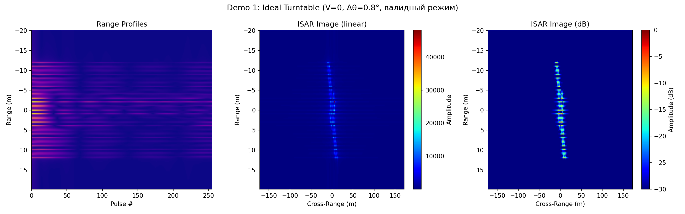
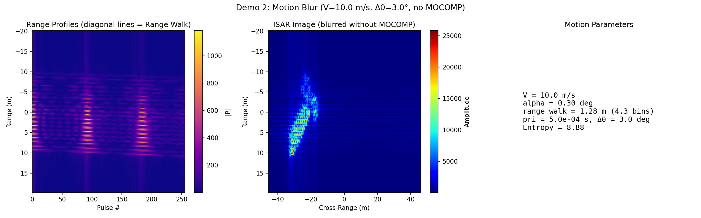
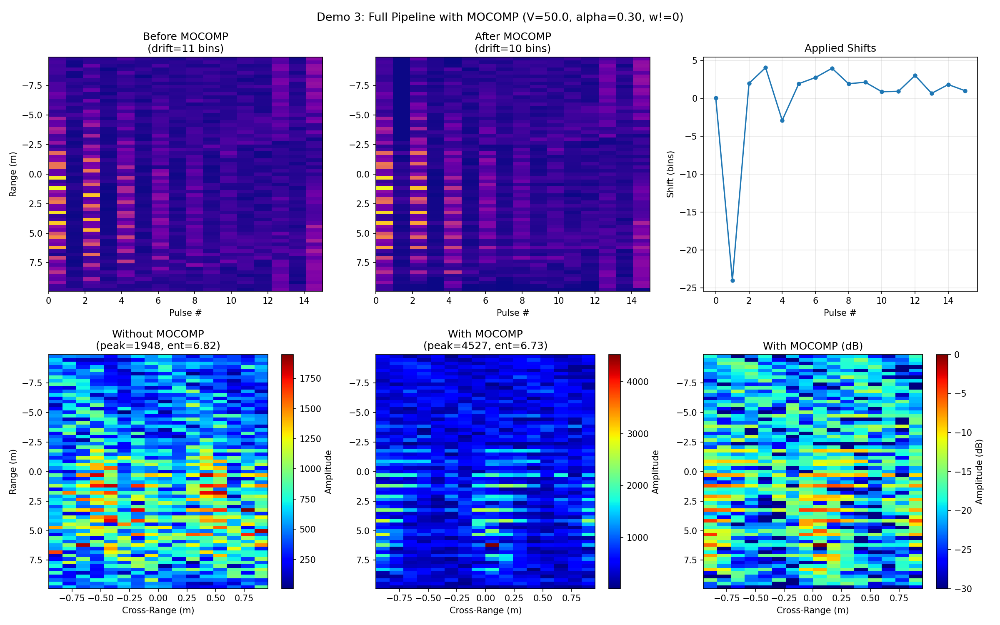
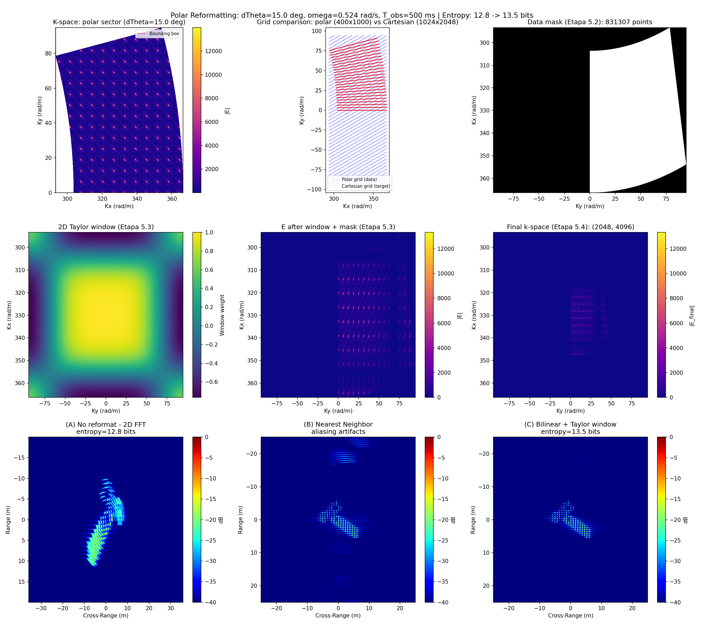
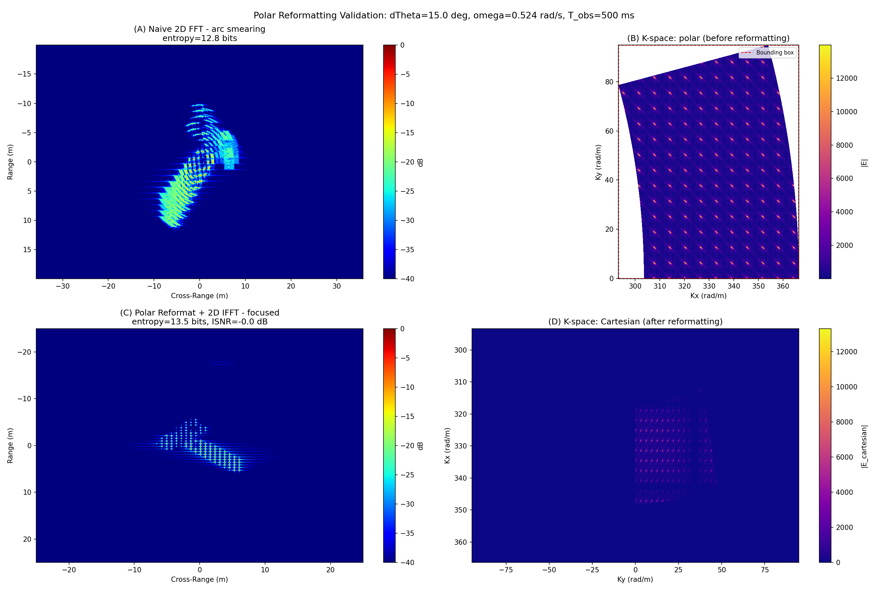
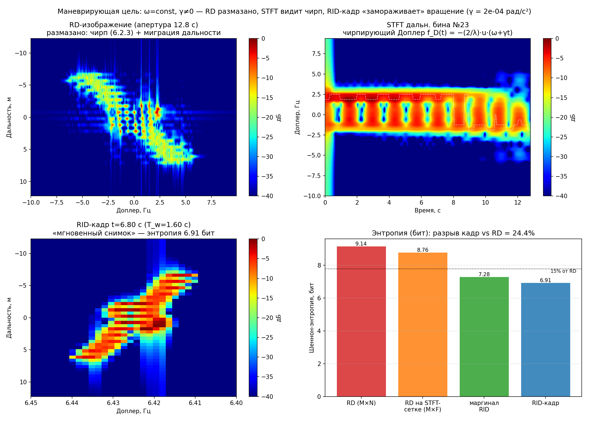
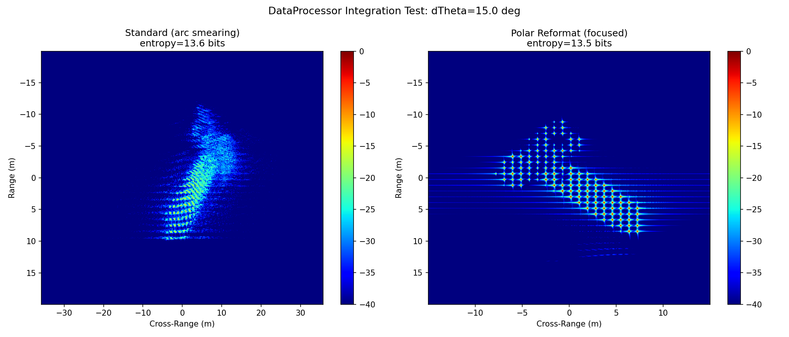

# Демо-скрипты и тесты

Папка `examples/` содержит 6 готовых скриптов для визуализации алгоритмов ISAR-обработки. Каждый скрипт запускается из корня проекта и автоматически сохраняет PNG-картинку в эту же директорию.

**Запуск из корня проекта:**

```bash
python -m examples.<имя_скрипта>
```

**Все скрипты сразу:**

```bash
python -m examples.demo_ideal_turntable
python -m examples.demo_motion_blur
python -m examples.demo_full_pipeline_mocomp
python -m examples.demo_large_angle
python -m examples.demo_polar_reformatting_validation
python -m examples.demo_maneuvering_target
python -m examples.test_data_processor_polar
```

---

## Демо 1: Идеальный разворот (Turntable Model) — валидный режим

**Скрипт:** `demo_ideal_turntable.py`

**Сценарий:** чистое вращение вокруг ЦМ без поступательного движения (V=0), Δθ=0.8° за апертуру. MOCOMP не нужен — РЛИ формируется идеально.

**Что показывает:** базовая корректность конвейера на **физически валидной** конфигурации (guard C1a 7.4×, C1b 14.3×, C2 1.67×, C4 1.10× — отчёт guard'а печатается в stdout). Цена честного малого угла: PSF по кросс-рейнджу 1.19 м. Печатает PSF-допуски и топ-5 истинных позиций рассеивателей (solarB_high); большие углы — демо 4/5 (полярный тракт).

**Параметры:** `satellite=solarB`, `Δθ=0.8°`, `N=256`, `PRI=50 мс`, `B=0.5 ГГц`, `X/Y=40/40 м`, `R0=500 км`

**Выход:** `demo_ideal_turntable.png`



---

## Демо 2: Размытие движением (Motion Blur) — валидный режим

**Скрипт:** `demo_motion_blur.py`

**Сценарий:** поступательное движение ЦМ (V=10 м/с, α=0.3°) + вращение Δθ=3°. MOCOMP **выключен**. Guard: все ok, кроме честного WARN по C4 (0.29× — полярный тракт для больших углов).

**Что показывает:** что происходит без компенсации движения:
- На профилях дальности — косые линии (Range Walk): аналитический ход 1.28 м = 4.3 бина за апертуру (без доплер-алиасинга: C1b 1.40×).
- РЛИ размыто, точки цели не различимы.

**Параметры:** `satellite=ICEsat2`, `V=10 м/с`, `Δθ=3°`, `N=256`, `PRI=0.5 мс`, `X/Y=40/40 м`

**Выход:** `demo_motion_blur.png`



---

## Демо 3: Полный конвейер с MOCOMP — тот же сценарий, MOCOMP включён

**Скрипт:** `demo_full_pipeline_mocomp.py`

**Сценарий:** идентичен демо 2 (тот же ICEsat2_high, V=10 м/с, Δθ=3°) — сравнение «до/после» честное.

**Что показывает:** работу компенсации движения:
1. Выравнивание огибающей убирает Range Walk (косые линии → горизонтальные).
2. Фазовый автофокус (PPP) убирает фазовый тренд.
3. Азимутальное FFT фокусирует точки: пик 25801 → 63244 (**×2.45**).

Метрики печатаются честные: аналитический ход (1.28 м), применённые сдвиги MOCOMP в метрах (−0.90…+3.60 — включают вращательную составляющую ярких элементов).

**Параметры:** `satellite=ICEsat2`, `V=10 м/с`, `Δθ=3°`, `N=256`, `PRI=0.5 мс`, `X/Y=40/40 м`

**Выход:** `demo_full_pipeline_mocomp.png`



---

## Демо 4: Большой угол поворота (Large Angle)

**Скрипт:** `demo_large_angle.py`

**Сценарий:** Δθ = 15° (ω=0.524 рад/с, N=1000, PRI=0.5 мс). V=0.

**Что показывает:** проблему, с которой справляется полярное переформатирование:
- **k-space:** данные лежат не на прямоугольнике, а на **кольцевом секторе** (полярная сетка).
- **Стандартное РЛИ:** точки растягиваются в **дуги** (arc smearing) — 2D БПФ на кривой сетке работает некорректно.
- **Полярная сетка vs декартова:** наглядное сравнение до и после переформатирования.

**Параметры:** `satellite=ICEsat2`, `ω=0.524 рад/с`, `Δθ=15°`, `B=1.5 ГГц`, `N=1000`

**Выход:** `demo_large_angle.png`



---

## Демо 5: Валидация полярного переформатирования

**Скрипт:** `demo_polar_reformatting_validation.py`

**Сценарий:** тройное сравнение методов для одной и той же цели с Δθ=15°.

**Что показывает:** три графика в одном окне:
- **(A) Наивный 2D FFT** — точки размазаны в дуги, энтропия высокая.
- **(B) k-space: до vs после** — слева кривая полярная сетка, справа выпрямленная декартова с нулями по углам.
- **(C) Polar Reformatting + 2D IFFT** — точки сфокусированы, энтропия минимальна.

**Метрики:** энтропия снижается, ISNR растёт.

**Параметры:** `satellite=ICEsat2`, `ω=0.524 рад/с`, `Δθ=15°`, `B=1.5 ГГц`, `N=1000`, `X/Y=40/30 м`

**Выход:** `demo_polar_reformatting_validation.png`



---

## Демо 6: Маневрирующая цель (RD vs STFT vs RID-кадр)

**Скрипт:** `demo_maneuvering_target.py`

**Сценарий:** равномерное вращение + угловое ускорение γ (маневрирующая цель, §6.5 плана; C&M, §3.2; TF, §5.4). Угол поворота
θ(t) = ω·t + 0.5·γ·t² — C&M, (1.13).

**Параметры:** `f_c=10 ГГц` (λ = 3 см), `B=300 МГц` (dr = 0.5 м), `PRI=0.05 с`, `N=256` (T = 12.8 с), `ω=0.01 рад/с`, `γ=2e-4 рад/с²` → Δθ_total ≈ 0.144 рад ≈ 8.3°; цель `solarB_mid` (кросс-рейндж до ≈ 7 м, веер Доплера цели ≈ 9.2 Гц < fs/2 = 10 Гц, без алиасинга).

**Что показывает (физика §6.2):** мгновенная угловая скорость θ̇(t) = ω + γ·t линейно растёт, поэтому Доплер каждого рассеивателя
f_D(t) ≈ −(2/λ)·u·(ω + γ·t) — линейный чирп (6.2.2)–(6.2.3). RD-изображение (азимутальное БПФ за всю апертуру T) честно размазывается — по Доплеру чирпом |df_D/dt|·T ≈ 2.1 Гц (критерий QPE (6.2.5) нарушается в ~30 раз), по дальности миграцией y·ω·T ≈ 0.9 м ≈ 1.8 dr. STFT-спектрограмма сильнейшего дальностного бина (панель 2) показывает наклонный чирпирующий гребень f_D(t). RID-кадр в середине апертуры (панель 3, окно T_w = 1.6 с) «замораживает» вращение: за время окна чирп набегает всего ≈ 0.3 Гц, что меньше разрешения кадра 1/T_w = 0.625 Гц (§6.2.3, §6.2.5) — получается «мгновенный снимок».

**Метрики (панель 4):** энтропия (compute_image_entropy) RD-изображения, RD на STFT-сетке, маргинала RID Σ_t|Q|² и отдельного RID-кадра. Энтропия кадра ниже энтропии RD минимум на 15 % (критерий приёмки §6.5), для наших параметров — ≈ 24 %.

**Выход:** `demo_maneuvering_target.png`



---

## Интеграционный тест: DataProcessor + Polar Reformat

**Скрипт:** `test_data_processor_polar.py`

**Что делает:** прогоняет полный конвейер через `DataProcessor` (тот же класс, что и GUI) для стандартного и полярного методов. Автоматически проверяет:
- Изображение не пустое (`peak > 0`)
- Энергия сконцентрирована (top-1% пикселей содержат >5% энергии)
- Оси корректные (метры, не радианы)
- Размерность осей совпадает с размерностью изображения

**Выход:** `test_data_processor_polar.png` (два графика: стандартный vs полярный), вывод в консоль с метриками.

**Запуск с проверками:**

```bash
python -m examples.test_data_processor_polar
# Вывод: [OK] Image is non-empty
#        [OK] Energy is concentrated
#        [OK] Axis sizes match image dimensions
#        [OK] Physical axes: x_span=40.0 m, y_span=30.0 m
#        ALL CHECKS PASSED
```

**Выход:** `test_data_processor_polar.png`



---

## Сравнение скриптов

| Скрипт | V | MOCOMP | Δθ | Метод | Что видно |
|--------|---|--------|-----|-------|-----------|
| demo_ideal_turntable | 0 | — | 0.8° | стандартный | Идеальные точки, guard-отчёт, PSF/истинные позиции |
| demo_motion_blur | 10 | выкл | 3° | стандартный | Range Walk 4.3 бина, размытие (guard ok, WARN C4) |
| demo_full_pipeline_mocomp | 10 | вкл | 3° | стандартный | Точки после MOCOMP (×2.45, ход 1.28 м) |
| demo_large_angle | 0 | — | 15° | стандартный + полярный | Arc smearing vs k-space |
| demo_polar_reformatting_validation | 0 | — | 15° | наивный / полярный | 3 графика сравнения |
| demo_maneuvering_target | 0 | — | 8.3°+γ | стандартный + STFT + RID | Чирп, smear vs RID-мгновенный снимок |
| demo_keystone | 0 | — | 14.7° | стандартный RD + keystone (§9.5 стенд) | Миграция 8.5 dr ⇒ фокус (до/после) |
| test_data_processor_polar | 0 | выкл | 15° | оба | Автотест с метриками |
